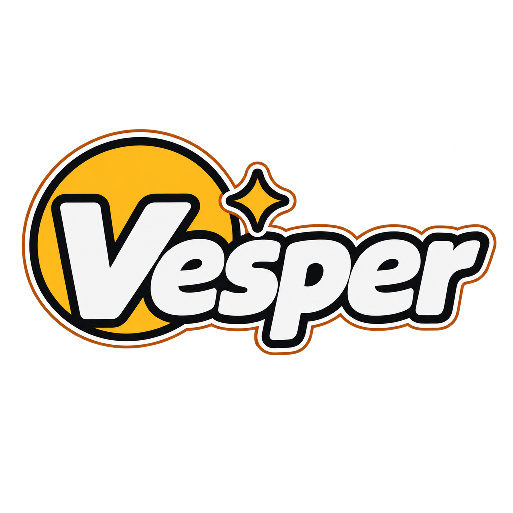

<div align="center">



### Voice chat for your friends, on your own server. The mic is the product.


</div>

---

Vesper is a small, self-hosted voice and text chat for one friend group. It runs in a desktop browser (Chrome or Firefox) and the server is a single Rust binary.

It exists because the other Discord replacements sound bad. Discord's edge is its noise suppression, so Vesper puts that first: a DeepFilterNet model runs in the browser as WASM, and your voice is cleaned before it is encoded and sent. Everything else is kept small on purpose. No games, no bots, no watch-together.

## What you get

| | |
|---|---|
| **Clean mic** | DeepFilterNet3 in an AudioWorklet and a Worker. If it fails to load or falls behind, the call keeps going on the browser's own suppression and the UI says so. |
| **Your bitrate** | Pick 32 to 510 kbps per person. Opus at 48 kHz, in-band FEC on, optional DTX. |
| **Voice controls** | Mute, deafen, per-person volume, a speaking ring, push to talk, a mic test with a level meter. |
| **A Rust SFU** | One UDP port carries all audio. The server forwards each person's Opus stream and never decodes it. |
| **Diagnostics** | Live round trip, jitter and loss, mic and denoiser levels, plus a "Test connection" button that tells you if UDP is blocked. |
| **Yours** | Self-hosted, no telemetry, accounts by invite only. |

## How it fits together

```
 browser (Chrome / Firefox)                         your server
┌─────────────────────────────┐  https + websocket  ┌──────────────────────────────┐
│ Svelte UI                   │◄───────────────────►│ Caddy ──► vesper-server      │
│ mic ─► DeepFilterNet (WASM) │                     │            web app, /ws,     │
│ Opus over WebRTC            │◄═ audio, UDP 40000 ═►│            presence, SFU     │
└─────────────────────────────┘                     └──────────────────────────────┘
```

Signaling and presence go over one WebSocket. Audio never goes through Caddy.

## Quickstart

You need Rust, Node and the `wasm32-unknown-unknown` target. From the repo root:

```bash
scripts/build-dsp.sh
npm --prefix web install && npm --prefix web run build
cargo run -p vesper-server -- create-owner   # prints a one-use link for the first account
VESPER_HTTP_BIND=127.0.0.1:8080 VESPER_UDP_BIND=127.0.0.1:40000 VESPER_WEB_DIR=web/dist cargo run -p vesper-server --release
```

Open the printed link to create the owner account, then sign in at http://127.0.0.1:8080. More detail, tests and the hot-reload setup are in [docs/dev.md](docs/dev.md).
For friends on other machines, see [docs/deploy.md](docs/deploy.md): Docker or systemd, Caddy for HTTPS, and forwarding UDP 40000 on your router.

## Status

Last updated 2026-10-30. This is a personal project and the voice foundation is built, not battle tested.

- Built and covered by tests: the SFU, the server, the web client, the load test (12 speakers for 30 s, no loss on a local run), the deploy files.
- **Not tried yet in a real browser:** Chrome and Firefox behaviour, the encoder bitrate after the Opus fix, the Docker build, a real deploy, the router forward.
- **Not measured yet:** the delay DeepFilterNet adds, and how the audio sounds next to Discord. [docs/testing/checkpoint.md](docs/testing/checkpoint.md) is the listening test.
- **Next:** text chat, accounts and rooms, a real design pass. Screen share is v2.

## Layout

| Path | What it is |
|---|---|
| `crates/vesper-protocol` | Wire types shared by the server and the client (TypeScript is generated from them). |
| `crates/vesper-sfu` | The audio SFU, built on [str0m](https://github.com/algesten/str0m). |
| `crates/vesper-server` | axum server: signaling, presence, the web app, `/health`. |
| `crates/vesper-dsp` | DeepFilterNet wrapper, native for tests and WASM for the browser. |
| `crates/vesper-loadtest` | Synthetic speakers for load and loss checks. |
| `web/` | The Svelte client. |
| `deploy/` | Dockerfile, compose, Caddyfile example, systemd unit. |

## Docs

- [docs/dev.md](docs/dev.md): build, run, test, the checks.
- [docs/env.md](docs/env.md): every environment variable.
- [docs/architecture.md](docs/architecture.md): how the parts fit.
- [docs/deploy.md](docs/deploy.md): Docker, Caddy, ports.
- [docs/runbook.md](docs/runbook.md): running it and fixing it.
- [docs/decisions/](docs/decisions/README.md): why it is built this way.
- [docs/known-issues.md](docs/known-issues.md): small things left on purpose.
- [docs/testing/checkpoint.md](docs/testing/checkpoint.md): the quality checkpoint, step by step.
- [docs/testing/latency.md](docs/testing/latency.md): measuring delay, loss and server load.
- [docs/rust-style.md](docs/rust-style.md) and [docs/ui-design.md](docs/ui-design.md): code rules and UI principles.
- [docs/superpowers/specs](docs/superpowers/specs): the design. [docs/superpowers/plans](docs/superpowers/plans): the build plan.
- [SECURITY.md](SECURITY.md): reporting a problem.

## Credits

[DeepFilterNet](https://github.com/Rikorose/DeepFilterNet) does the noise suppression. [str0m](https://github.com/algesten/str0m) does WebRTC on the server.

## License

MIT, see [LICENSE](LICENSE).

The DeepFilterNet3 model is not in this repository: `scripts/fetch-model.sh` downloads it from the DeepFilterNet repository, which licenses it under MIT or Apache-2.0. The research corpus (CSTR VCTK, CC BY 4.0) is downloaded by `research/scripts/` and is not in the repository either. Dependencies keep their own licenses; `cargo deny check licenses` lists the allowed ones in `deny.toml`.
